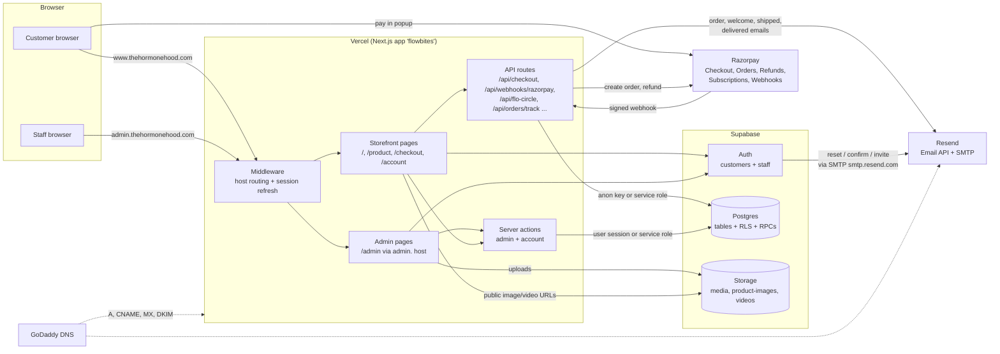
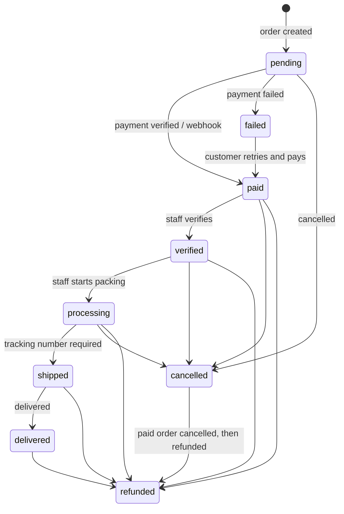

# The Hormone Hood (FloBites) - Knowledge Transfer Guide

This guide hands the website over to the client's developers and operations team. It describes what the system does, how it is built, how to run and deploy it, and how to operate it day to day.

Developers should read all sections. Operations staff can go straight to [Admin panel guide](#12-admin-panel-guide-for-operations-staff), [Emails](#13-emails), and [Troubleshooting](#15-troubleshooting--faq).

> No secret values appear in this document. Environment variables are listed by name only. Keep real values in your password manager, in Vercel, and in your local `.env.local` file (which is git-ignored).

## Table of contents

1. [Overview](#1-overview)
2. [Architecture](#2-architecture)
3. [Code map](#3-code-map)
4. [Local development setup](#4-local-development-setup)
5. [Deployment](#5-deployment)
6. [Database](#6-database)
7. [Third-party services and accounts to hand over](#7-third-party-services-and-accounts-to-hand-over)
8. [Customer flows](#8-customer-flows)
9. [Order lifecycle and state machine](#9-order-lifecycle-and-state-machine)
10. [Discounts, Love Score and Flo Circle rules](#10-discounts-love-score-and-flo-circle-rules)
11. [Admin access and roles](#11-admin-access-and-roles)
12. [Admin panel guide for operations staff](#12-admin-panel-guide-for-operations-staff)
13. [Emails](#13-emails)
14. [Security notes](#14-security-notes)
15. [Troubleshooting / FAQ](#15-troubleshooting--faq)
16. [Known limitations and recommended next steps](#16-known-limitations-and-recommended-next-steps)

---

## 1. Overview

**What it is.** An online store for **The Hormone Hood**, a brand selling period-care snack bars in India. The shop name used in the interface and emails is **FloBites** (the bars are "Flo Bites", sold in "THE FLO" and "THE FLO+" editions). Customers can browse, add to cart, pay online in INR via Razorpay, track orders, and manage an account. A loyalty programme called **Flo Circle** gives members discounts, perks, gifts and events.

**What the site does**

- Storefront: home page, product pages, blog, CMS pages (privacy, terms, shipping, refunds, contact, about), guest order tracking.
- Checkout with Razorpay (cards, UPI, etc. as enabled on the Razorpay account), plus an optional Rs 1 Flo Circle join at checkout.
- Customer account portal: orders, invoice, cancel, return request, membership, auto-delivery records, support tickets, wishlist, profile, savings, perks, gifts, launches, events.
- Admin panel for staff: orders, returns, support, products, content (pages, posts, FAQs, testimonials, banners, media, videos), discounts, Flo Circle management, staff management.
- Transactional emails through Resend.

**URLs**

| What | URL |
|---|---|
| Storefront | https://www.thehormonehood.com |
| Admin panel | https://admin.thehormonehood.com |
| Razorpay webhook endpoint | https://www.thehormonehood.com/api/webhooks/razorpay |
| Contact / reply-to email | reach@thehormonehood.com |
| Sender for system emails | noreply@thehormonehood.com |
| Old domains | `thoressfoods.com` and `flowbites.vercel.app` redirect (HTTP 308) to `www.thehormonehood.com` |
| Supabase project | ref `vvlyqvahfaowwjaflumd`, region `ap-south-1` (Mumbai) |
| Vercel project | `flowbites`, team `flow-bites` |

The apex `thehormonehood.com` is configured in DNS; the canonical public host is `www`.

### Tech stack

| Layer | Technology | Version | Docs |
|---|---|---|---|
| Framework | Next.js (App Router, Turbopack) | 15.5 | https://nextjs.org/docs |
| UI | React | 19.1 | https://react.dev |
| Language | TypeScript | 5 | https://www.typescriptlang.org/docs |
| Styling | Tailwind CSS | 4 | https://tailwindcss.com/docs |
| Animation | Framer Motion | 12 | https://motion.dev/docs |
| Icons | Lucide React | 1.x | https://lucide.dev |
| Client state | Zustand (cart, wishlist) | 5 | https://zustand.docs.pmnd.rs |
| Validation | Zod | 4 | https://zod.dev |
| Database, Auth, Storage | Supabase (Postgres, Auth, Storage; Mumbai region) | supabase-js 2 | https://supabase.com/docs |
| Payments | Razorpay (orders, refunds, subscriptions, webhooks) | razorpay 2.9 | https://razorpay.com/docs |
| Email | Resend (app emails + Supabase Auth SMTP + inbound reach@) | resend 6 | https://resend.com/docs |
| Hosting | Vercel (Node 24.x) | - | https://vercel.com/docs |
| Domain / DNS | GoDaddy (thehormonehood.com) | - | https://www.godaddy.com/help |

### Links

**Live site**

| What | URL |
|---|---|
| Storefront | https://www.thehormonehood.com |
| Admin panel | https://admin.thehormonehood.com |
| Guest order tracking | https://www.thehormonehood.com/track |
| Customer account | https://www.thehormonehood.com/account |
| Razorpay webhook endpoint | https://www.thehormonehood.com/api/webhooks/razorpay |
| Contact email | reach@thehormonehood.com |

**Dashboards** (sign-in required)

| Service | URL |
|---|---|
| Source code (GitHub) | https://github.com/mkrinfotech-web/flowbites-code |
| Hosting (Vercel project `flowbites`) | https://vercel.com/flow-bites/flowbites |
| Database & Auth (Supabase project) | https://supabase.com/dashboard/project/vvlyqvahfaowwjaflumd |
| Payments (Razorpay) | https://dashboard.razorpay.com |
| Email (Resend) | https://resend.com/emails |
| Domain DNS (GoDaddy) | https://dcc.godaddy.com/control/portfolio/thehormonehood.com/settings?tab=dns |

---

## 2. Architecture

One Next.js application serves both the storefront and the admin panel. The admin panel is the same code, reached through the `admin.` hostname which the middleware rewrites to the `/admin` route tree. Server code talks to Supabase either as the signed-in user (subject to row-level security) or with the **service-role key** (bypasses security, used only on the server for checkout, webhooks, emails and a few admin operations).



**Request routing (src/middleware.ts)**

- Hostnames `admin.thehormonehood.com` and `admin.localhost` are "admin hosts". On an admin host, `/` is rewritten to `/admin` and any other path (except `/auth`, `/api`, `/_next`, `/images`, `/favicon`) is rewritten to `/admin/<path>`.
- Any request whose path starts with `/admin` (on any host, including `www`) goes through admin protection: unauthenticated users are sent to `/admin/login`; signed-in users who are not active staff/admin are signed out and sent to `/account`. Login, forgot-password and update-password pages are public.
- On the storefront, the middleware refreshes the Supabase session cookies and protects `/account/*` (except login, signup, forgot, update-password).
- `robots.ts` disallows `/admin/`, `/api/`, `/account/`, `/checkout/`. `sitemap.ts` lists static routes, products and published CMS pages.

**Data access pattern**

| Client | File | Used for |
|---|---|---|
| Server client (user session, cookies) | `src/lib/supabase/server.ts` | Reading data as the logged-in user; most admin actions (RLS applies) |
| Browser client | `src/lib/supabase/client.ts` | Client-side auth |
| Service-role admin client | `src/lib/supabase.ts` (`getSupabaseAdmin`) | Checkout, webhooks, emails, refunds, stock, staff invites, customer account actions |

If `NEXT_PUBLIC_SUPABASE_*` variables are missing, the storefront falls back to built-in static product data (`src/lib/data.ts`, `src/lib/product-catalog.ts`). In production Supabase is the source of truth.

---

## 3. Code map

### 3.1 Top level

| Path | Purpose |
|---|---|
| `src/` | All application code |
| `supabase/migrations/` | SQL migrations 001 to 020 (see [Database](#6-database)) |
| `supabase/seed.sql` | Early seed for products, FAQs, testimonials |
| `supabase/auth-email-templates/` | HTML templates for Supabase Auth emails (confirm sign-up, magic link, reset password, invite) plus a README |
| `scripts/` | `configure-auth-resend-smtp.mjs` (applies Auth SMTP + templates via the Supabase Management API), `seed-product-editions.mjs` (upserts the 8 edition products) |
| `public/` | Static assets: `images/` (logo, products, UI, stories posters, website art), `videos/` (showcase and testimonial MP4s), icons |
| `files/` | Original design/brand source files (product photos, fonts, videos). Not used at runtime |
| `.env.example` | Template of environment variables |
| `next.config.ts` | Allows remote images from `www.figma.com` and `vvlyqvahfaowwjaflumd.supabase.co` |
| `eslint.config.mjs`, `tsconfig.json`, `postcss.config.mjs` | Tooling config |
| `.vercel/` | Local link to the Vercel project (git-ignored) |

### 3.2 `src/app` (routes)

**Storefront**

| Route | File | Notes |
|---|---|---|
| `/` | `page.tsx` | Home: hero, best sellers (editions), love score, ingredients, stories, showcase, comparison, testimonials, Flo Circle section, FAQ |
| `/product/[slug]` | `product/[slug]/page.tsx` | Product page |
| `/checkout`, `/checkout/success` | `checkout/` | Checkout form, Razorpay popup, result page |
| `/flo-circle` | `flo-circle/` | Programme landing page and join |
| `/blog`, `/blog/[slug]` | `blog/` | Posts from the `posts` table |
| `/[slug]` | `[slug]/page.tsx` | CMS pages from the `pages` table (privacy, terms, shipping, refunds, contact, about). Reserved slugs that cannot be used: admin, api, checkout, blog, ingredients, product, account, flo-circle |
| `/track`, `/orders/track` | `track/`, `orders/track/` | Guest order tracking (email + order number) |
| `/auth/confirm`, `/auth/callback` | `auth/` | Email-link landing routes (see [Customer flows](#8-customer-flows)) |
| `sitemap.xml`, `robots.txt`, icons, `not-found` | `sitemap.ts`, `robots.ts`, `icon.png`, ... | SEO and branding |

**Account portal** (`src/app/account`)

- Public: `login`, `signup`, `forgot`, `update-password`.
- Protected (`(portal)` group): hub (`/account`), `orders`, `orders/[id]` (+ `invoice`), `wishlist`, `membership`, `subscriptions` (shown as Auto-delivery), `profile`, `support`, `savings`, `perks`, `gifts`, `launches`, `events`.
- `actions.ts` (login, signup, forgot/update password, profile) and `order-actions.ts` (customer cancel order, request return) are server actions.

**Admin** (`src/app/admin`)

- Public: `login`, `forgot`, `update-password`.
- Dashboard group `(dashboard)`: `/admin` (dashboard), `orders`, `orders/[id]`, `returns`, `support`, `products`, `pages` (+ `new`, `[id]`), `posts` (+ `new`, `[id]`), `faqs`, `testimonials`, `banners`, `media`, `videos`, `discounts`, `flo-circle` (+ `plans`, `members`, `subscriptions`, `gifts`, `events`), `staff`.
- Server actions: `actions.ts` (login, orders, refunds, emails, products, staff, pages, discounts, media), `cms-actions.ts` (FAQs, testimonials, banners, posts), `flo-actions.ts` (plans, gifts, events, launches, members, subscriptions, discount settings), `support-actions.ts` (return and ticket status), `video-actions.ts`.

**API routes** (`src/app/api`)

| Route | Purpose |
|---|---|
| `POST /api/checkout/create-order` | Validates cart, stock and discounts, saves the order as `pending`, creates the Razorpay order |
| `POST /api/checkout/verify` | Verifies the Razorpay payment signature and marks the order paid |
| `POST /api/webhooks/razorpay` | Signed webhook: payment and subscription events |
| `POST /api/discount/validate` | Checks a coupon or Love Score code |
| `POST /api/love-score` | Generates a Love Score code from a name |
| `POST /api/orders/track` | Guest order lookup (rate limited) |
| `GET /api/products`, `GET /api/faqs` | Public data |
| `/api/flo-circle/*` | `plans`, `events`, `me`, `join`, `subscribe`, `rsvp`, `support`, `membership/action`, `subscription/action` |
| `GET /api/admin/orders/export` | Staff-only CSV export |

### 3.3 `src/lib` (modules)

| File | Purpose |
|---|---|
| `site.ts` | Brand constants: `SITE_DOMAIN`, admin hostnames, contact email, sender name, business address (footer) |
| `supabase.ts`, `supabase/*` | Supabase clients and session middleware helper |
| `admin-auth.ts` | `requireStaff()` guard used by every admin server action; `adminBaseUrl()` |
| `admin-utils.ts` | Order status list and labels, revenue statuses, CSV escape, order timeline, Markdown renderer for CMS pages |
| `order-transitions.ts` | The order state machine (see [section 9](#9-order-lifecycle-and-state-machine)) |
| `order-refunds.ts` | Razorpay refunds, stock restore, admin note helper |
| `razorpay.ts`, `razorpay-client.ts`, `payments-env.ts` | Razorpay SDK, signature checks, demo-checkout gate |
| `flo-circle.ts` | Discount constants and pure rules (stacking, member timing) |
| `flo-circle-server.ts` | Post-payment side effects, stock decrement, membership activation, email sending wrappers, guest account creation |
| `discount-codes.ts`, `love-score.ts` | Code validation and Love Score calculation |
| `email.ts` | Resend email builders (welcome, confirmation, shipped, delivered) |
| `products.ts`, `product-catalog.ts`, `data.ts`, `product-content.ts`, `product-display.ts`, `product-images.ts` | Product loading (database first, static fallback) and display helpers |
| `cms.ts`, `media.ts`, `videos.ts`, `video-types.ts`, `static-media-seed.ts`, `assets.ts` | CMS content, banners, media and videos |
| `cart-store.ts`, `wishlist-store.ts` | Browser-side cart and wishlist (Zustand, saved in localStorage) |
| `rate-limit.ts` | Small in-memory rate limiter |
| `validations.ts` | All Zod input schemas |
| `customer-orders.ts`, `utils.ts` | Helpers (customer order filter, safe redirect, session id) |

### 3.4 `src/components`

`admin/` (admin shell, forms, uploaders, confirm buttons), `home/` (homepage sections, footer, popups), `layout/site-header.tsx`, `cart/cart-drawer.tsx`, `product/` (add-to-cart actions, rich accordion, wishlist button).

### 3.5 Project notes

This guide (`docs/KT.md`), the `README.md` and the code are the source of truth. Build-time planning notes and design comparison screenshots were kept out of this repository. `.env*` files (except `.env.example`) are git-ignored and must never be committed.


---

## 4. Local development setup

**Prerequisites**

- Node.js **24.x** (this matches the Vercel project setting; the code was last built locally with 24.19).
- npm (a `package-lock.json` is committed).
- Access to the Supabase project (or your own test project with all migrations applied) for the keys.

**Steps**

```bash
npm install
cp .env.example .env.local      # then fill in the values
npm run dev                     # http://localhost:3000 (Turbopack)
```

**Admin panel locally:** open `http://admin.localhost:3000`. Modern browsers resolve `*.localhost` automatically; if yours does not, add `127.0.0.1 admin.localhost` to your hosts file. Log in with a staff account that exists in your Supabase project.

**Scripts**

| Command | What it does |
|---|---|
| `npm run dev` | Dev server with Turbopack |
| `npm run build` | Production build (Turbopack) |
| `npm start` | Run the production build |
| `npm run lint` | ESLint |
| `npm run deploy` / `npm run deploy:vercel` | `npx vercel --prod --yes` (production deploy) |

There is no test script (see [limitations](#16-known-limitations-and-recommended-next-steps)).

### 4.1 Environment variables

All names come from the code and `.env.example`. Never commit values.

| Variable | Required | Where used | Purpose |
|---|---|---|---|
| `NEXT_PUBLIC_SUPABASE_URL` | Yes | Browser and server | Supabase project URL |
| `NEXT_PUBLIC_SUPABASE_ANON_KEY` | Yes | Browser and server | Public Supabase key; access is limited by row-level security |
| `SUPABASE_SERVICE_ROLE_KEY` | Yes (production) | Server only | Full-access key for checkout, webhook, emails, refunds, staff invites. **Never expose to the browser** |
| `NEXT_PUBLIC_APP_URL` | Yes | Server | Public storefront origin, no trailing slash (production: `https://www.thehormonehood.com`; local: `http://localhost:3000`). Used in emails, auth links, sitemap. Falls back to `https://www.thehormonehood.com` if unset |
| `NEXT_PUBLIC_ADMIN_URL` | Yes (production) | Server | Admin origin (production: `https://admin.thehormonehood.com`). Used in staff invite and admin password-reset links. If unset it falls back to `http://admin.localhost:3000`, which would break those links in production |
| `NEXT_PUBLIC_RAZORPAY_KEY_ID` | Yes (for payments) | Browser and server | Razorpay public key id |
| `RAZORPAY_KEY_SECRET` | Yes (for payments) | Server only | Razorpay secret; signs and verifies payments and is used for refunds |
| `RAZORPAY_WEBHOOK_SECRET` | Yes (for payments) | Server only | Verifies webhook signatures. Must equal the secret set on the Razorpay webhook |
| `RAZORPAY_ALLOW_DEMO_WEBHOOK` | No | Server | `1` accepts unsigned webhooks, only if no webhook secret is set. For local testing only; never set in production |
| `ALLOW_DEMO_CHECKOUT` | No | Server | `1` allows "demo" checkout and membership activation without Razorpay in production. Outside production, demo mode is on automatically when Razorpay keys are missing. **Never set in production** |
| `RESEND_API_KEY` | Yes (for email) | Server; also Supabase Auth SMTP password | Resend key. If missing, app emails are silently skipped |
| `EMAIL_FROM` | Recommended | Server; script | Sender header, e.g. `FloBites <noreply@thehormonehood.com>` on the verified domain. If unset, the code defaults to `FloBites <reach@thehormonehood.com>` |
| `SUPABASE_ACCESS_TOKEN` | Scripts only | `scripts/configure-auth-resend-smtp.mjs` | Personal access token for the Supabase Management API. Not used by the running site |

`NODE_ENV` and `VERCEL_ENV` are provided automatically; the code treats either being `production` as production.

---

## 5. Deployment

**How the site is deployed today.** Manually, with the Vercel CLI. There is **no Git auto-deploy** and no CI pipeline. The production build is created from whatever is in your working folder when you run the command.

```bash
npx vercel login                # once, with the account that owns team 'flow-bites'
npx vercel link                 # once per machine; choose project 'flowbites'
npm run build                   # optional local check first
npm run deploy                  # = npx vercel --prod --yes
```

**Recommended routine:** run `npm run lint` and `npm run build` locally, optionally deploy a preview first with `npx vercel` (no `--prod`), test it, then run `npm run deploy`. After a deploy, place a test order and check admin login (see checklist below).

**Environment variables in Vercel.** Project `flowbites` > Settings > Environment Variables. Add every variable from [section 4.1](#41-environment-variables) for the **Production** environment (and Preview if you want previews to work with real data; use test keys for previews). Variables are read at build/start, so **redeploy after changing any variable**.

**Domains.** Project > Settings > Domains. Expected entries: `www.thehormonehood.com` (primary), `thehormonehood.com` (apex), `admin.thehormonehood.com`, and the old domains `thoressfoods.com` and `flowbites.vercel.app` configured to redirect to `www.thehormonehood.com`. DNS is at GoDaddy: `A @` to `216.198.79.1` and `64.29.17.1`; `CNAME www` and `CNAME admin` to Vercel. Do not delete the Resend records listed in [section 7](#7-third-party-services-and-accounts-to-hand-over).

**Rolling back.** In the Vercel dashboard open the project > Deployments, find the last good production deployment, open its menu (the three dots) and choose **Promote to Production** (or **Instant Rollback**, shown on older deployments). Rollback takes effect immediately and does not touch the database. If a bad release also ran a database migration, the migration is not undone; fix forward with a new migration.

**Post-deploy checklist**

1. Home page and a product page load; images appear.
2. `/admin/login` loads on `admin.thehormonehood.com` and a staff login works.
3. Add to cart and open checkout; the Razorpay popup opens (use test keys for pre-production checks).
4. After a real or test payment, the order appears in Admin > Orders as **Paid** and the confirmation email arrives.

**Auth settings that must stay correct (Supabase Dashboard > Authentication > URL Configuration):** Site URL `https://www.thehormonehood.com`; redirect allow-list containing `https://www.thehormonehood.com/**`, `https://thehormonehood.com/**`, `https://admin.thehormonehood.com/**`. Email templates in `supabase/auth-email-templates` use the `token_hash` link flow through `/auth/confirm`.

---

## 6. Database

Supabase Postgres. Schema changes live in `supabase/migrations/*.sql`. Row-level security (RLS) is enabled on the tables below.

### 6.1 Tables by area

**Catalogue and content**

| Table | Purpose |
|---|---|
| `products` | Sellable items: name, slug, tagline, description, pack label, `price_inr`, `image_path`, `images` (gallery JSON), `badge`, `shelf_color`, `stock_qty`, `sort_order`, `is_active`, `edition` (`flo` or `flo_plus`), `content` (JSON: formal/punchy description, nutrition summary and bullets, ingredients, footer notes) |
| `faqs`, `testimonials` | Homepage FAQ and testimonials (`is_active`, `sort_order`) |
| `pages` | CMS pages: `slug`, `title`, `type` (policy, landing, about, contact, ingredient, custom), `body_md` (Markdown), SEO fields, `is_published` |
| `posts` | Blog posts |
| `banners` | Announcement banners; placement `homepage_top`, `homepage_mid`, `sitewide` or `checkout`; optional start/end dates |
| `media_assets` | Media library records |
| `videos` | Carousel videos; placement `stories`, `showcase` or `both` |

**Orders and payments**

| Table | Purpose |
|---|---|
| `orders` | One row per order: number (`FLO-...`), customer name/email/phone, shipping address (JSON), subtotal, discount, membership fee, total, `status`, Razorpay ids, `tracking_number`, `admin_notes`, audit timestamps (`paid_at`, `verified_at`, `shipped_at`, `cancelled_at`), email-sent flags (`confirmation_email_sent_at`, `shipped_email_sent_at`, `delivered_email_sent_at`), `stock_decremented_at`, `user_id`, member flags |
| `order_items` | Line items with product name and prices captured at purchase time |
| `discount_codes` | Coupons and Love Score codes: `code`, `percent_off` (1 to 50), `kind` (`love_score` or `manual`), `max_uses`, `use_count`, `expires_at`, `used_at`, `is_active`, `session_id` |
| `return_requests` | One return request per order (reason, message, status) |

**Accounts and staff**

| Table | Purpose |
|---|---|
| `profiles` | One row per auth user. `role` is `admin`, `staff` or `customer`; `is_active` flag. This table decides who can use the admin panel |
| `member_profiles` | Customer profile: member id (`FLO-C-XXXXXX`), name, email, phone |
| `member_addresses` | Saved addresses |

**Flo Circle**

| Table | Purpose |
|---|---|
| `flo_circle_plans` | Plans: slug, name, price, `duration_days`, `razorpay_plan_id`, perks, `is_active` (includes the Rs 1 / 180-day `flo_circle_intro` plan) |
| `flo_circle_memberships` | A user's membership: `status`, `started_at`, `ends_at`, Razorpay subscription id, cancel info, `admin_notes` |
| `flo_subscriptions`, `flo_subscription_items` | Auto-delivery records (cadence, next ship date, items) |
| `flo_savings_ledger` | Savings per discounted order |
| `flo_perks`, `flo_member_perks` | Perk definitions and unlocks |
| `flo_gifts` | Gift queue (welcome gift is queued automatically) |
| `flo_events`, `flo_event_rsvps` | Events and RSVPs |
| `flo_launches` | Early-access launch announcements |
| `flo_support_tickets` | Support tickets from customers |
| `site_settings` | Key/value settings: `discount_stack_mode`, `flo_circle_discount_timing`, `flo_circle_member_percent`, `subscribe_save_percent` |

### 6.2 Key status values

| Where | Values |
|---|---|
| `orders.status` | `pending`, `paid`, `verified`, `processing`, `shipped`, `delivered`, `failed`, `refunded`, `cancelled` |
| `flo_circle_memberships.status` | `pending`, `active`, `paused`, `past_due`, `cancelled`, `expired` (nothing in the code sets `expired` today) |
| `flo_subscriptions.status` | `pending`, `active`, `paused`, `skipped`, `cancelled`, `past_due` |
| `return_requests.status` | `open`, `in_progress`, `approved`, `rejected`, `refunded`, `closed` |
| `flo_support_tickets.status` | `open`, `in_progress`, `closed` |
| `flo_support_tickets.category` | `cancel_membership`, `cancel_sub`, `general`, `shipping`, `order`, `return` |
| `flo_gifts.status` | `queued`, `assigned`, `shipped`, `delivered`, `cancelled` |
| `flo_event_rsvps.status` | `going`, `waitlist`, `cancelled` |
| `profiles.role` | `admin`, `staff`, `customer` |

### 6.3 Row-level security model

- Helper functions: `is_staff()` is true for an **active** profile with role `admin` or `staff`; `is_admin()` is true for an active `admin`. (`is_staff()` was tightened in migration 009 so a customer profile is never staff.)
- Public (anyone) can read active products, FAQs, testimonials, banners, published pages and posts, active plans, perks, events, launches, active videos, and site settings.
- Customers can read only their own orders (by `user_id` or by matching email), order items, member profile, addresses, memberships, subscriptions, savings, perks, gifts, RSVPs, support tickets and return requests, and can insert their own tickets and return requests.
- Staff (`is_staff()`) can read and write the operational tables; `profiles` management is admin-only.
- New sign-ups always get role `customer`: the `handle_new_user` trigger ignores any role supplied by the client (migration 009).
- Writes done by the server with the service-role key (checkout, webhook, cancel/return actions, stock, emails) bypass RLS by design.

### 6.4 Storage buckets

All three are public for reading by URL; only staff can list, upload, update or delete objects.

| Bucket | Purpose | Limit and types |
|---|---|---|
| `product-images` | Product photos uploaded from Admin > Products | 10 MB; JPEG, PNG, WebP, GIF |
| `media` | Media library | 50 MB; images (JPEG, PNG, WebP, GIF, SVG) and PDF |
| `videos` | Carousel videos and posters | 500 MB; MP4, WebM, QuickTime, and images |

### 6.5 Database functions (RPCs)

| Function | Purpose |
|---|---|
| `is_staff()`, `is_admin()`, `is_customer()` | Role checks used by policies |
| `handle_new_user()` | Trigger: creates a `profiles` row (role `customer`) when an auth user is created |
| `set_updated_at()` | Trigger helper for `updated_at` columns |
| `decrement_stock_for_order(p_order_id)` | Reduces stock for a paid order exactly once (guarded by `orders.stock_decremented_at`); stock never goes below 0. Callable by the service role only |
| `link_guest_orders_for_user(p_user_id, p_email)` | Attaches earlier guest orders with the same email to a user. Service role only |

### 6.6 Applying migrations

There is no migration runner in the repo. Apply files **in numeric order** using either:

- Supabase Dashboard > SQL Editor: paste and run each new file, or
- the Supabase CLI (`supabase link --project-ref vvlyqvahfaowwjaflumd`, then `supabase db push`). The `supabase/.temp` folder shows the project has been linked this way from a developer machine.

All migrations are written to be re-runnable (`if not exists`, `on conflict`, `drop ... if exists`), but always test on a copy first. Take a backup before any change (Supabase Dashboard > Database > Backups).

**Duplicate `006_` numbering.** Two files start with `006_`: `006_carousel_videos.sql` and `006_flo_circle_intro.sql`. Both are needed and independent. Do **not** rename them (a note in migration 010 says the same). When adding new migrations continue from `021_`.

Order summary: 001 base tables; 002 CMS, profiles, staff helpers and policies; 003 CMS page seeds; 004 Flo Circle tables; 005 customer account and guest-order linking; 006 videos table and bucket; 006 Flo Circle intro plan (Rs 1 / 180 days) and `membership_fee_inr`; 007 stop public listing of videos bucket; 008 `verified` status and audit columns; 009 security fix for `is_staff` and sign-up role; 010 indexes and storage buckets; 011 product-images bucket; 012 confirmation-email and stock columns plus stock RPC; 013 membership admin notes; 014 seed of storefront videos and banners; 015 return requests and cancel columns; 016 shipped/delivered email flags; 017 product rich content; 018 contact email text in pages; 019 hero copy and FAQ; 020 product editions.

---

## 7. Third-party services and accounts to hand over

Transfer **ownership** (not just a shared login) of each account to the client's company, enable two-factor authentication, and record who the billing contact is.

| Service | Used for | Where settings live |
|---|---|---|
| **Vercel** (team `flow-bites`, project `flowbites`) | Hosting, domains, environment variables, deployment history and rollback | Project Settings > Environment Variables, Domains; Deployments tab; Logs tab for runtime errors |
| **Supabase** (project `vvlyqvahfaowwjaflumd`, ap-south-1) | Database, customer and staff login, file storage | Dashboard: Table Editor, SQL Editor, Authentication (Users, URL Configuration, SMTP, Email Templates), Storage, Project Settings > API (keys), Database > Backups. Check the plan: free tiers pause and have limited backups, so upgrade before relying on it for live sales |
| **Razorpay** | Taking payments, refunds, optional subscriptions | Dashboard: Settings > API Keys (key id and secret), Webhooks (URL `https://www.thehormonehood.com/api/webhooks/razorpay`, secret, events `payment.captured`, `payment.failed`, and the `subscription.*` events), Subscriptions > Plans (plan ids to copy into Admin > Flo Circle > Plans), Payments/Refunds for reconciliation. Test mode and live mode have separate keys, plans and webhooks |
| **Resend** | Sending app emails (API) and Supabase Auth emails (SMTP `smtp.resend.com`, user `resend`, password = the Resend API key) | Dashboard: Domains (`thehormonehood.com` is verified), API Keys, Emails (delivery log), Inboxes (receives mail for `reach@thehormonehood.com`) |
| **GoDaddy** (DNS for `thehormonehood.com`) | Domain and DNS | DNS records: `A @` to `216.198.79.1` and `64.29.17.1`; `CNAME www` and `CNAME admin` to Vercel; Resend DKIM TXT `resend._domainkey`; Resend CNAMEs `send` and `rsend`; `MX @` to `receive-apne1.forge.rmta.net`. Also holds domain renewal |
| **GitHub** | Source code repository | Confirm the repository owner, collaborators and branch protection. There are no GitHub Actions workflows and Vercel is not connected for auto-deploy |

**Credentials to collect:** Supabase service-role key and anon key, Razorpay key id/secret/webhook secret, Resend API key, Supabase personal access token (only if you will run `scripts/configure-auth-resend-smtp.mjs`), Vercel access. Rotate any key that has been shared in chat, email or screenshots.

**Rotating a secret:** generate a new one in the provider's dashboard, update it in Vercel (and in Supabase Auth SMTP if it is the Resend key), then redeploy. For the Razorpay webhook secret, change it in both the Razorpay webhook settings and `RAZORPAY_WEBHOOK_SECRET`.

---

## 8. Customer flows

### 8.1 Browse and cart

- Products come from the `products` table (active rows, sorted by `sort_order`), with built-in static data as a fallback. Product pages show the rich content accordion (description, nutrition, ingredients).
- The cart is kept in the customer's browser (`localStorage` key `flo-cart-v3`) and shown in a drawer. It is not stored on the server until checkout creates an order.

### 8.2 Love Score and discount codes

- On the home page, a visitor enters a name and gets a "Love Score" code (see [section 10](#10-discounts-love-score-and-flo-circle-rules)). The code is saved to `discount_codes` for 24 hours and tied to that browser's session id.
- Staff can also create ordinary coupon codes (Admin > Discounts).
- At checkout the code is checked by `/api/discount/validate`, and checked again on the server when the order is created. The server never trusts a percentage from the browser.

### 8.3 Flo Circle Rs 1 join at checkout

- The checkout has a "Join Flo Circle" option, ticked by default. If the customer is not already an active member, Rs 1 is added to the order and a `pending` membership on the `flo_circle_intro` plan (180 days) is created. The intro plan is always used, whatever the browser sends.
- Guests who join get an account created for them automatically with no password. They claim it later with **Forgot password** on the account login page.
- When the order is paid, the membership becomes `active` for 180 days, a welcome email is sent and a welcome gift is queued.

### 8.4 Checkout and payment

1. The customer fills name, email, phone (10 to 15 digits) and address (line 1, city, state, 6-digit pincode).
2. The browser calls `POST /api/checkout/create-order`. The server:
   - reads prices from the database (not from the browser), checks stock (rejects with "out of stock" or "Only N left"),
   - applies the best discount (see section 10), adds the Rs 1 join fee if applicable (the total is never below Rs 1),
   - saves `orders` (status `pending`) and `order_items`,
   - creates a Razorpay order and stores its id.
3. The Razorpay popup opens (`checkout.razorpay.com`). The customer pays.
4. On success the browser calls `POST /api/checkout/verify` with the payment id and signature. The server checks the signature, confirms it matches the order, sets status `paid` with `razorpay_payment_id` and `paid_at`, and runs the paid side effects.
5. **In parallel, Razorpay calls the webhook** (`payment.captured`). It does the same update, so an order is still marked paid if the customer closes the browser before step 4. Both paths are safe to run twice.
6. If Razorpay reports `payment.failed`, a still-`pending` order becomes `failed`. A customer can retry on the same Razorpay order; a later successful payment moves `failed` back to `paid`.
7. The customer lands on `/checkout/success` and the cart is cleared.

If Razorpay keys are missing: outside production the order is marked paid immediately as a "demo" order; in production the API returns "payments unavailable" (HTTP 503) unless `ALLOW_DEMO_CHECKOUT=1` is set (do not set it).

### 8.5 What happens when an order becomes paid

`applyPaidOrderSideEffects` (`src/lib/flo-circle-server.ts`) runs from both verify and webhook and is safe to repeat:

1. Activates the pending Flo Circle membership attached to the order (and sends the welcome email once).
2. Marks the discount code used (single-use codes burn on the first paid order; multi-use codes count paid orders up to `max_uses`).
3. Writes a row to the savings ledger if a discount was given to a signed-in customer.
4. Reduces product stock through the `decrement_stock_for_order` function (once per order).
5. Sends the order confirmation email (once per order, tracked by `confirmation_email_sent_at`).

### 8.6 Tracking

- Guests: `/track` asks for email and order number and calls `POST /api/orders/track`. It shows status, dates and tracking number. The same vague "not found" message is returned whether the order or the email is wrong. Limited to 8 lookups per minute per IP address (per server instance).
- Signed-in customers see the same in the account portal.
- The shipped email contains the tracking number, and the customer-facing tracking number is whatever staff typed in the admin panel (a courier reference).

### 8.7 Account portal

All pages need login. Sign-up asks for name, email, password (8+ characters) and optional phone, and sends a confirmation email (Supabase Auth through Resend). When a customer signs up or logs in, earlier guest orders with the same email are linked to the account.

| Page | What the customer can do |
|---|---|
| Hub (`/account`) | Summary, membership status, days remaining |
| Orders / order detail | List and detail of orders; links to invoice; **Cancel** and **Request return** (rules below) |
| Invoice | Printable invoice page (use the Print button; there is no PDF generation and no tax breakdown) |
| Membership | Join a plan, pause, resume, cancel, change plan |
| Auto-delivery | View, pause, resume, skip, swap, cancel auto-delivery records (see limitations) |
| Support | Send a ticket (categories include general, shipping, order) and see history |
| Wishlist | Saved items; stored only in the browser (`flo-wishlist-v1`) |
| Profile | Name, phone, address |
| Savings, Perks, Gifts, Launches, Events | Member benefits; events allow RSVP |

**Customer cancel rules** (`src/app/account/order-actions.ts`): allowed only when the order is `pending`, `paid` or `verified`. The order becomes `cancelled`, stock is put back if it had been reduced, and for paid orders an admin note "Customer cancelled after payment - refund needed" is added. **The customer is not refunded automatically.** Staff must issue the refund (see [section 12.4](#124-cancel-and-refund-an-order)). Once an order is `processing` or later, the customer is told to contact Support.

**Customer return rules:** allowed only when the order is `shipped` or `delivered`. One return request per order. It creates a `return_requests` row (reason: damaged, wrong item, quality, changed mind, other) and also a support ticket of category `return`. Staff handle it from Admin > Returns.

### 8.8 Sign-in links and password reset

- Customers: `/account/forgot` sends a reset email. The link goes to `/auth/confirm?token_hash=...&type=recovery&next=/account/update-password`, which signs them in and shows the new-password form.
- Staff: `/admin/forgot` sends a similar link to `<NEXT_PUBLIC_ADMIN_URL>/auth/confirm?next=/admin/update-password`.
- `/auth/confirm` uses the `token_hash` flow, which works on any device or browser. `/auth/callback` is the older code-exchange route and only works in the same browser that requested the email.
- A failed or expired link redirects to `/account/login?error=auth` ("That link expired. Sign in or reset again.").

---

## 9. Order lifecycle and state machine

Rules live in `src/lib/order-transitions.ts`. Every admin and customer status change goes through `canTransitionOrderStatus`.



**Allowed moves**

| From | To |
|---|---|
| `paid` | `verified` (normal), `cancelled`, `refunded`, `failed` |
| `verified` | `processing` (normal), `cancelled`, `refunded` |
| `processing` | `shipped` (normal; **tracking number mandatory**), `cancelled`, `refunded` |
| `shipped` | `delivered` (normal), `refunded` |
| `delivered` | `refunded` |
| `pending` | `failed`, `cancelled` (staff cannot jump a pending order to paid; payment does that) |
| `cancelled` | `refunded` |
| `failed`, `refunded` | none (final) |

The forward path is strictly one step at a time; staff cannot skip steps. The order page only offers valid next statuses.

**What each change does**

- `verified`: records `verified_at` and which staff member verified.
- `shipped`: records `shipped_at`, saves the tracking number, and sends the **shipped email** (once).
- `delivered`: sends the **delivered email** (once).
- `cancelled`: records `cancelled_at` and a reason ("Cancelled by staff" or the note typed), and puts stock back. If the order has a payment, a warning reminds staff that **no refund was issued**.
- `refunded`: first performs a real Razorpay refund (below). If Razorpay refuses or is not configured, **the order is not marked refunded** and an error is shown. If the order has no online payment (for example a demo order), it is just marked refunded with a note.

**Stock**

- Stock is reduced when an order is **paid** (not when it is placed), via `decrement_stock_for_order`, once per order, never below zero. At checkout the server rejects quantities above the current stock but does not hold stock between "pending" and "paid", so two customers can occasionally race for the last unit.
- Stock is restored (`restoreStockForOrder`) when an order moves to `cancelled` or `refunded`, once only (guarded by clearing `stock_decremented_at`). If some products cannot be restored, staff see a warning to check inventory.
- Editing stock by hand is done in Admin > Products.

**Refunds** (`src/lib/order-refunds.ts`)

- Refunds are always the **full remaining amount** of the order total, sent to Razorpay with normal speed. Partial refunds of a chosen amount are not supported in the panel (do those in the Razorpay dashboard).
- Before refunding, the code asks Razorpay what has already been refunded on that payment. If the payment is already fully refunded, nothing new is sent and the order is simply marked.
- Allowed from `paid`, `verified`, `processing`, `shipped`, `delivered` and `cancelled`.
- The result (refund id and amount) is added to the order's admin notes.
- The order page shows the list of Razorpay refunds for the payment.
- The app does not email the customer about cancellation or refund.

**Admin timeline.** The order page shows Placed, Paid, Verified, Processing, Shipped, Delivered, plus the final state if cancelled, failed or refunded.

---

## 10. Discounts, Love Score and Flo Circle rules

| Rule | Detail |
|---|---|
| Love Score | A name gives a fixed percentage between 16 and 20 (same name, same result). Code looks like `FLO<NAME><percent>`. Valid for 24 hours, and only in the browser session that created it |
| Coupons | Created in Admin > Discounts. Percent 1 to 50, optional max uses, expiry date. A coupon without a max-uses value is single-use |
| Member discount | Flo Circle members get 20%. **When** it applies is controlled in Admin > Discounts: `second_order` (default: from the second paid order onward), `first_order`, `always`, or `never` |
| Stacking | Default `best_of_one`: only the single highest percentage among member 20%, Love Score and coupon is used (ties prefer member, then coupon, then Love Score). `stack_all` adds them up to a 50% cap |
| Flo Circle intro | Rs 1 for 180 days, added at checkout (plan slug `flo_circle_intro`) |
| Other plans | Monthly (30 days), 3 Months (90), 6 Months (180), Yearly (365), editable in Admin > Flo Circle > Plans; prices are stored in the database |
| Minimum total | The order total is never below Rs 1 (or the join fee when joining) |

Joining a **paid plan** from the account page uses Razorpay Subscriptions and needs a `razorpay_plan_id` on the plan (see [Flo Circle admin](#127-flo-circle)). Without keys and a plan id, production returns "payments unavailable".

---

## 11. Admin access and roles

| Role | Can do |
|---|---|
| **staff** | Everything operational: orders, refunds, emails, returns, support, products (edit/create, stock, images), pages, posts, FAQs, testimonials, banners, media, videos, discounts, Flo Circle management, CSV export |
| **admin** | Everything staff can do, plus: invite staff, change staff roles, deactivate or reactivate staff, **delete** products, **delete** pages |

Notes:

- The **Staff** menu item is visible to admins only.
- A staff or admin account must have `profiles.role` of `admin` or `staff` and `is_active = true`. Customers who try to open the admin panel are signed out and sent to `/account`.
- An admin cannot demote or deactivate their own account.
- The first admin was created directly in Supabase. To create one manually: create the user in Supabase Authentication > Users, then set that user's row in `profiles` to `role = 'admin'`, `is_active = true`.

---

## 12. Admin panel guide for operations staff

Open **https://admin.thehormonehood.com**. The left menu has: Dashboard, Orders, Returns, Support, Products, Pages, Posts, FAQs, Testimonials, Banners, Media, Videos, Discounts, Flo Circle, and Staff (admins only).

### 12.1 Log in, log out, forgot password

1. Go to the admin address and enter your email and password (at least 8 characters).
2. If you see "No staff access for this account", ask an admin to check that your account is active and has the staff or admin role.
3. **Forgot password:** click the forgot-password link, enter your email, open the email, click the button, and set a new password. Links expire; if one fails, request a new one. If no email arrives, see [Troubleshooting](#15-troubleshooting--faq).
4. A new teammate receives an **invite email** from an admin; the link lets them set a password.

### 12.2 Dashboard

Shows cards for: Revenue (paid and later orders), Orders today, **Paid - await verify**, In fulfilment queue, Flo Circle active members, **Open returns**, **Open tickets**, Products, Pages, a count of orders by status, and the 8 most recent orders. Click a card to jump to the matching list. Check the "Paid - await verify", Open returns and Open tickets cards at least daily.

### 12.3 Processing an order (step by step)

Open **Orders**. Use the status filter and the search box (order number, customer email or name). Each order can be handled from the list (quick buttons) or from its own page (click the order number).

1. **New paid order.** Status **Paid - needs verify**. Open it and check the items, address and phone. Click **Verify order** if everything is fine. The order becomes **Verified**.
2. **Start processing.** Click **Start processing** when you begin packing. Status **Processing**.
3. **Ship.** Enter the courier **tracking number** in the Tracking field and click **Mark shipped**. The system will not allow shipping without a tracking number. The customer gets the **shipped email** automatically. Status **Shipped**.
4. **Deliver.** When the courier confirms delivery click **Mark delivered**. The customer gets the **delivered email**. Status **Delivered**.

Other tools on the order page:

- **Save changes** lets you edit notes, tracking number and status together; only valid next statuses are offered.
- **Admin notes** are internal; the customer never sees them.
- A yellow/red banner after an action explains anything that needs follow-up (for example "email failed" or "stock restore incomplete").
- Orders that include Flo Circle show a "Flo Circle join" or "Member order" tag. Member orders are marked priority; pack them first.
- **Pending** orders are unpaid carts that reached checkout. Do not ship them. They become Paid by themselves when payment completes, or Failed.

### 12.4 Cancel and refund an order

**Cancel** (before shipping): on the order page click **Cancel** (a confirmation appears). Stock goes back automatically. If the customer already paid, the page warns "Order cancelled but the payment was NOT refunded - use Refund to customer."

**Refund:** on the order page click **Refund to customer** and confirm. The system sends the refund to Razorpay for the full amount that has not been refunded yet and records the refund id in the notes. The order is marked **Refunded** and stock is restored. Money reaches the customer according to Razorpay and their bank (usually several working days).

Typical cases:

| Situation | What to do |
|---|---|
| Customer cancelled their own paid order | The order shows a note "refund needed". Click **Refund to customer** |
| You cancel a paid order | Click **Cancel**, then **Refund to customer** |
| Return approved after delivery | Click **Refund to customer** on the order (marking a return "Refunded" on the Returns page does **not** send money) |
| Refund shows an error | Read the message. "Razorpay is not configured" means refund from the Razorpay dashboard. Never mark an order refunded without sending the money |
| Order has no payment id (for example a test or demo order) | There is nothing to send; the order can only be marked refunded manually |

Partial refunds are not supported in the panel; use the Razorpay dashboard and add a note on the order.

### 12.5 Resend emails

On the order page, under the emails sections:

- **Resend confirmation email** sends the order confirmation again.
- **Resend shipped email** and **Resend delivered email** appear when relevant.

Each asks for confirmation. Check the customer's email address on the order first. If the key for email is missing the message is skipped and you will see a warning (see Troubleshooting).

### 12.6 Returns and Support

**Returns** (customer return requests): filter by status. Each card shows the order (click through to it), customer, reason and message. Change the dropdown to **open, in progress, approved, rejected, refunded** or **closed** and save. This only records progress; **it does not refund or email the customer.** Contact the customer yourself (their email is shown) and, if approved, refund from the order page.

**Support** (tickets from the account area, including cancellation notices and returns): filter by status and category. Each ticket shows the member name, email, category, reason and message. Set the status to **open, in progress** or **closed**. There is no reply box; answer the customer by email from reach@thehormonehood.com.

### 12.7 Products

**Products** lists every product as an editable card. You can change:

- Name, **price** (rupees), **stock quantity**, sort order, edition (THE FLO or THE FLO+), active on/off.
- **Images:** upload a new image (JPEG, PNG, WebP or GIF up to 10 MB) or set the image path.
- **Content** (the accordion on the product page): formal and punchy descriptions, nutrition summary and bullets, nutrition disclaimer, ingredients list, "contains" list and footer note.

Click save on the card. Changes appear on the storefront. Setting a product inactive hides it from the shop but keeps old orders intact. A product with stock 0 cannot be ordered ("out of stock"). Admins can also create new products and delete them: **soft delete** just deactivates; **hard delete** removes the row permanently (avoid for products that have orders).

Price changes apply to new orders only; existing orders keep the price they were bought at.

### 12.8 Discounts and settings

**Discounts** page:

- **Create a coupon:** code (stored in capitals), percent off (1 to 50), optional max uses, expiry date. Leave max uses empty for a single-use code.
- Switch codes on or off in the table. Love Score codes created by visitors also appear here.
- **Discount stacking** and **When 20% member discount applies** settings: see [section 10](#10-discounts-love-score-and-flo-circle-rules). Change only on the founder's instruction; they affect all checkouts immediately.

### 12.9 Pages, Posts, FAQs, Testimonials, Banners, Media, Videos

- **Pages:** policy and info pages (privacy, terms, shipping, refunds, contact, about). Content is Markdown (headings with #, bullet lists, bold, links). Use **New** to add a page; set a URL slug and tick published. The page is at `/<slug>`. Delete is admin-only. **Important:** the original page texts were seeded with the earlier company name and email domain; review every policy page for the correct brand name, address and `reach@thehormonehood.com` before relying on them.
- **Posts:** blog articles shown at `/blog`. Create, edit, publish or unpublish.
- **FAQs / Testimonials:** add, edit, reorder (sort order), hide (inactive) or delete. They appear on the home page.
- **Banners:** announcement bars. Choose placement (top of home page, middle of home page, site-wide, checkout), text, button label and link, and active dates.
- **Media:** upload images or PDFs to the media library and copy their public URL for use in pages and posts. Deleting a file that is still in use breaks it on the site.
- **Videos:** the stories and showcase carousels on the home page. Upload a video (up to 500 MB; MP4, WebM, QuickTime) and optional poster, choose placement, reorder, switch on/off, or delete. "Import" copies the videos that ship with the site into the library.

### 12.10 Flo Circle

Menu **Flo Circle** (overview shows active members and upcoming subscription shipments), with sub-pages:

- **Plans:** create or edit plans (name, slug, price, duration in days, description, active). Paste the Razorpay **plan id** (`plan_...`) from Razorpay > Subscriptions > Plans into the Razorpay plan id field to allow live paid sign-ups. Do not change the `flo_circle_intro` plan unless the founder asks.
- **Members:** list of memberships with status and end date. You can **Pause**, **Resume** or **Cancel** (a note can be added); if the membership has a Razorpay subscription, the change is also sent to Razorpay. Add internal notes (timestamped with your email).
- **Subscriptions:** auto-delivery records with next ship date; staff can cancel with a reason. Remember these are records only (see limitations); they do not create orders.
- **Gifts:** queue of gifts (a welcome gift is queued automatically when someone joins). Update status (queued, assigned, shipped, delivered, cancelled) and add notes. You must pack and send gifts yourself.
- **Events** and **Launches:** add events (title, date, location, description, published) and early-access launches (title, teaser, go-live time, body, published). Members see these in their account.

### 12.11 Staff management (admins only)

**Staff** page:

- **Invite:** enter email, optional name and role (staff or admin). If the person already has an account they are upgraded; otherwise they receive an invite email to set a password.
- **Change role** or **deactivate/reactivate** a person using the controls on their row. You cannot change or deactivate your own account. Deactivate people who leave the team immediately.

### 12.12 Export orders to CSV

On the Orders page click the export link. It downloads up to the latest 2,000 orders matching the current filters (status, search, customer). Columns include order number, status, customer name/email/phone, totals, discount, membership fee, tracking number and dates. Open in Excel or Google Sheets.

---

## 13. Emails

| Email | Trigger | Sent by | Subject | Notes |
|---|---|---|---|---|
| Order confirmation | Order becomes paid (verify or webhook) | Resend API | `Order confirmed · <order number>` | Once per order. Staff can resend |
| Shipped | Status changed to Shipped | Resend API | `On its way · <order number>` | Contains tracking number. Once; staff can resend |
| Delivered | Status changed to Delivered | Resend API | `Delivered · <order number>` | Once; staff can resend |
| Flo Circle welcome | Membership activated | Resend API | `Welcome to Flo Circle` (with a sparkle) | Once per membership |
| Confirm sign-up | Customer registers | Supabase Auth via Resend SMTP | Supabase template | Template: `supabase/auth-email-templates/confirm-signup.html` |
| Reset password | Forgot password (customer or staff) | Supabase Auth via Resend SMTP | Supabase template | `reset-password.html` |
| Magic link | Magic-link sign-in if used | Supabase Auth via Resend SMTP | Supabase template | `magic-link.html` |
| Staff invite | Admin invites staff | Supabase Auth via Resend SMTP | Supabase template | `invite.html` |

- **Sender:** the `EMAIL_FROM` value (recommended `FloBites <noreply@thehormonehood.com>`); **reply-to** is always `reach@thehormonehood.com`. The sending domain is verified in Resend.
- **Templates for app emails** are written in code in `src/lib/email.ts` (HTML plus plain text). Edit there and redeploy.
- **Templates for Auth emails** are in `supabase/auth-email-templates/`. They must be pasted into Supabase Dashboard > Authentication > Email Templates, or applied with `node scripts/configure-auth-resend-smtp.mjs` (needs `SUPABASE_ACCESS_TOKEN` and `RESEND_API_KEY`; the script also sets the SMTP host, Site URL and redirect allow-list).
- **Not sent by the app:** order cancelled, refunded, return-status or support-reply emails. Contact those customers manually.
- Replies to `reach@thehormonehood.com` arrive in Resend Inboxes (MX points to Resend receiving).

---

## 14. Security notes

- **Service-role key** (`SUPABASE_SERVICE_ROLE_KEY`) bypasses all row-level security. It is read only in server code (`src/lib/supabase.ts`) and must never carry the `NEXT_PUBLIC_` prefix or be sent to the browser.
- **Row-level security** protects data when the browser or a staff session talks to Supabase directly. Most admin actions use the staff member's own session, so RLS enforces staff access as a second layer. Every admin action also calls `requireStaff()`; admin-only actions call `requireStaff({ role: "admin" })`.
- **Server-side pricing:** the checkout reads prices and stock from the database, recomputes discounts on the server, and ignores client-supplied discount percentages or plan ids. Discount codes must exist in the database and be valid.
- **Payments:** payment signatures (HMAC SHA-256) are verified in constant time for both the browser verify call and the webhook. Unsigned webhooks are rejected unless `RAZORPAY_ALLOW_DEMO_WEBHOOK=1` and no webhook secret exists. Demo checkout is blocked in production unless `ALLOW_DEMO_CHECKOUT=1`.
- **Sign-up roles:** new users are always `customer`, enforced in the database trigger.
- **Open redirects:** login and email-link redirects pass through `safeRedirectPath`, which only allows local paths.
- **Admin host:** the admin panel is the same app on `admin.thehormonehood.com`. It is also reachable at `www.thehormonehood.com/admin` (still protected by login and role checks). It is blocked from search engines by `robots.txt`.
- **Secrets handling:** `.env*` files (except `.env.example`), `envs.json` and `.admin-bootstrap-credentials.txt` are git-ignored. Keep real values only in Vercel, your password manager and your local `.env.local`. Rotate any secret that has ever been shared.
- **Staff hygiene:** use unique passwords, enable two-factor authentication on Vercel, Supabase, Razorpay, Resend, GoDaddy and GitHub, and deactivate leavers on the Staff page the same day.
- **Rate limiting** exists only on guest order tracking and is per server instance (see limitations). There is no CAPTCHA.
- **Personal data:** orders hold names, emails, phone numbers and addresses. Limit who gets admin access and treat CSV exports as sensitive.

---

## 15. Troubleshooting / FAQ

**A customer paid but the order is still Pending (or Failed).**
1. Razorpay Dashboard > Payments: confirm the payment is "Captured".
2. Razorpay > Webhooks: check recent deliveries to `https://www.thehormonehood.com/api/webhooks/razorpay`. A 400 "Invalid signature" means `RAZORPAY_WEBHOOK_SECRET` in Vercel does not match the secret on the webhook. Fix the value and redeploy, then use Razorpay's "resend" on the failed delivery.
3. Make sure the webhook is active and subscribed to `payment.captured` and `payment.failed` (plus `subscription.*` events if you use subscriptions). Live and test mode have separate webhooks.
4. Check the Vercel project > Logs for errors from `/api/webhooks/razorpay` and `/api/checkout/verify`.
5. Test and live keys must not be mixed: `NEXT_PUBLIC_RAZORPAY_KEY_ID` and `RAZORPAY_KEY_SECRET` must be from the same mode.

If a payment is captured and the webhook cannot be replayed, a developer can confirm the order by calling the verify flow or by editing the order in Supabase; do not mark an order paid by hand unless the payment is confirmed in Razorpay.

**Checkout says "Online payments aren't available right now".** Razorpay keys are missing in the Vercel environment. Add `NEXT_PUBLIC_RAZORPAY_KEY_ID` and `RAZORPAY_KEY_SECRET` and redeploy.

**Emails are not arriving (order, shipped, welcome).**
1. Check `RESEND_API_KEY` is set in Vercel. If it is missing, emails are silently skipped and the "sent" flags stay empty.
2. Resend Dashboard > Emails: look for the message and its status (bounced, delivered, failed). Confirm the domain `thehormonehood.com` still shows Verified; if DNS records were removed at GoDaddy the domain falls out of verification.
3. Check `EMAIL_FROM` uses the verified domain.
4. Ask the customer to check spam, and confirm the email address on the order.
5. Use **Resend confirmation / shipped / delivered email** on the order page once fixed.

**Password reset, sign-up confirm or invite emails are not arriving.** These come from Supabase Auth, not the app. In Supabase Dashboard > Authentication > SMTP check that custom SMTP is on: host `smtp.resend.com`, port 465, user `resend`, password = a valid Resend API key, sender on the verified domain. If the key was rotated, update it here too. Without custom SMTP Supabase's built-in sender is heavily rate limited.

**Login or reset link says it expired.** Links are single-use and time-limited. Request a new one. Also check Authentication > URL Configuration still lists the redirect URLs from [section 5](#5-deployment). Opening the link on another device is fine (token_hash flow); old PKCE-style links only work in the original browser.

**A staff member can log in but is sent to the account page, or "No staff access".** Their `profiles` row must have `role` admin or staff and `is_active` true. An admin can fix it on the Staff page.

**Invite or admin reset link points to `admin.localhost`.** `NEXT_PUBLIC_ADMIN_URL` is not set in Vercel. Set it to `https://admin.thehormonehood.com` and redeploy.

**Product shows "out of stock" but there is stock.** Check the stock quantity in Admin > Products. Stock is reduced when orders are paid and restored on cancel/refund; unpaid orders do not reduce it.

**Stock numbers look wrong after cancel/refund.** The order page showed a warning if restore failed. Correct the quantity by hand in Admin > Products.

**Shipping fails with "Tracking number is required".** Enter the tracking number, then click Mark shipped.

**"Illegal status change".** The order state machine does not allow that jump (for example Paid straight to Shipped). Follow Verify, Processing, Shipped, Delivered.

**Refund failed.** Read the message. Common causes: Razorpay keys missing or from the wrong mode, payment older than the refund window, or the payment already fully refunded (the system then just marks it). Check the Razorpay dashboard.

**Customer says their discount code does not work.** Love Score codes last 24 hours and only work in the browser session that created them. Coupons can be expired, inactive or out of uses (Admin > Discounts). Only the best single discount applies by default.

**Guest cannot find their order on /track.** Email and order number must both match exactly what was entered at checkout. Lookups are limited to 8 per minute.

**Images or videos do not load.** Check the file still exists in Supabase Storage. Remote images are only allowed from the Supabase host and figma.com (`next.config.ts`).

**Where do I see errors?** Vercel > project > Logs (runtime errors from API routes and actions); Supabase > Logs; Razorpay > Webhooks and Payments; Resend > Emails.

---

## 16. Known limitations and recommended next steps

These were checked against the code. They are not bugs that block selling, but you should know them.

**Customer-facing**

1. **Wishlist is browser-only.** It lives in `localStorage` (`flo-wishlist-v1`) on that device. It is not saved to the account and does not sync across devices. The cart behaves the same way (`flo-cart-v3`).
2. **Auto-delivery is a record, not a billed schedule.** `flo_subscriptions` rows (cadence, next ship date) can be created, paused, skipped and cancelled, but nothing charges customers or creates orders when the date arrives. There is no cron job or scheduled function in the project, and no storefront screen currently calls the "start auto-delivery" API. Treat it as unfinished.
3. **Memberships do not expire automatically.** The `ends_at` date is stored and displayed, but nothing flips a membership to `expired`, and the member discount is based only on `status = 'active'`. The Rs 1 intro membership (180 days) is paid through the order, not through a recurring subscription, so it stays active until staff pause or cancel it. Paid plans on Razorpay Subscriptions are updated by webhook events. Plan a periodic check or scheduled job.
4. **No automatic refund on customer cancel.** Staff must refund manually. Marking a return as "refunded" does not move money.
5. **Refunds are full-remaining-amount only** in the panel.
6. **No cancel/refund/return emails** and no support reply emails from the app.
7. **Invoice is a print page.** No PDF, no GST/tax breakdown, no invoice numbers beyond the order number.
8. **Seeded CMS page texts** (privacy, terms, shipping, refunds, contact, about) were written with the earlier company name and old domain email; migration 018 also set the contact address to the old domain. Review and edit every page in Admin > Pages. The footer business address in `src/lib/site.ts` is a placeholder (company name and "Hyderabad, Telangana, India") to be replaced with the confirmed legal address.
9. **Low-stock race.** Stock is checked at checkout but reduced only on payment, so the last unit can be oversold in rare cases.

**Technical**

10. **No automated tests and no CI.** There is no test runner, test file or GitHub Actions workflow. Only `npm run lint` and `npm run build` are available. Recommended: add tests for `order-transitions`, discount rules and the checkout/verify/webhook routes, and a CI job that runs lint and build.
11. **Rate limiter is in-memory** (`src/lib/rate-limit.ts`). On Vercel each serverless instance has its own counter, so limits are soft and reset on cold starts. It is used only on order tracking. Login, discount validation, Love Score generation and checkout are not rate limited. Recommended: a shared store (for example Redis/Upstash) or Vercel firewall rules, and CAPTCHA on public forms.
12. **No Git auto-deploy.** Deploys come from a developer machine via the CLI, so what is live depends on that folder. Recommended: connect the GitHub repository to Vercel (production branch plus preview deployments).
13. **No migration tooling.** Migrations are applied by hand in order; there is no record in the repo of which ones are applied on production. Recommended: use the Supabase CLI migration history.
14. **Hard-coded values:** `SITE_DOMAIN` and addresses in `src/lib/site.ts`, the Supabase project ref and URL list in `scripts/configure-auth-resend-smtp.mjs`, and the Supabase image host in `next.config.ts`. Update all of them if the domain or Supabase project changes.
15. **Static product fallback.** If Supabase is unreachable the storefront shows built-in static products (`src/lib/data.ts`, `src/lib/product-catalog.ts`) that may not match live prices, and the checkout then uses those prices. Keep the database healthy and consider removing the fallback once stable.
16. **Webhook coverage.** Only the events listed in section 7 are handled. Refunds made directly in the Razorpay dashboard do not update the order automatically; update the order status and notes by hand.
17. **Large components.** `src/app/admin/actions.ts` is long and mixes many concerns; consider splitting it by area when you next change it.
18. **Rotate secrets after handover:** generate new Supabase service-role, Razorpay and Resend keys once ownership is transferred, and update them in Vercel.
19. **Operations hardening:** enable Supabase backups on a paid plan, set up uptime monitoring on the home page and `/api/products`, and add alerting on webhook failures (Razorpay can email on repeated webhook failures).

**Suggested priority:** (1) automatic membership expiry check, (2) review CMS legal pages and footer address, (3) connect GitHub to Vercel and add CI, (4) tests for the order and payment paths, (5) decide the future of auto-delivery (build billing or remove the screens), (6) shared rate limiting.
